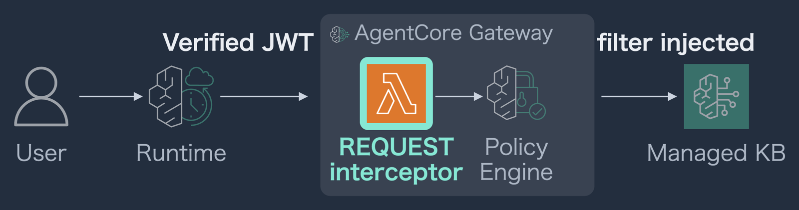

# Filter What the LLM Reads

Put a Bedrock Managed Knowledge Base behind an AgentCore Gateway, and the
per-role narrowing has to live *somewhere*. This repository holds the one
place it fits — and a read-only script that checks whether yours is actually
there.



The role comes from the **verified** JWT. The REQUEST interceptor overwrites
the data-layer filter on the way in, before the knowledge base is ever read.
Nothing the model wrote survives that step.

Supporting code for the talk *"Filter What the LLM Reads: RAG Governance with
AgentCore Gateway"* — AWS Community Day Hong Kong, 2026-10-24, room LW003.
Speaker and author: **Shinnosuke Yakumo**
([@yakumo_09](https://x.com/yakumo_09)), AWS Community Builder (AI
Engineering), JAWS-UG NIIGATA.

---

## What is here

| | |
|---|---|
| [`interceptor.py`](interceptor.py) | The REQUEST interceptor. Two target shapes, one rule: **overwrite, do not validate.** The trap that silently passes new tools through is marked in the code |
| [`audit.py`](audit.py) | Five read-only checks against your own Gateway. Creates nothing, deletes nothing |
| [`docs/findings.md`](docs/findings.md) | **What I measured.** Seven ways this breaks quietly, with the numbers |

## Check your own Gateway

```bash
pip install boto3
python audit.py --gateway <gateway-id> --region us-west-2 --kb <kb-id>
```

Pass `--token <JWT>` to call `tools/list` for real instead of deriving the
tool names from the target definitions. The difference matters: the derived
list is what you configured, `tools/list` is what the caller actually sees,
and finding 2 lives in the gap between them.

It reads and reports; it creates nothing and deletes nothing. Needed:
`bedrock-agentcore:GetGateway`, `ListGatewayTargets`, `GetGatewayTarget`,
`lambda:GetFunction`, `logs:FilterLogEvents`, `bedrock:GetKnowledgeBase`,
`bedrock:GetResourcePolicy`.

Sample output, against the environment the talk was measured on:

```
2. Interceptors (2)
  ok   cdhk-request-interceptor (REQUEST) mentions every exposed tool
  ok     no exception is logged-and-forgotten
  NG   cdhk-response-audit (RESPONSE) never mentions: kbtools___kb_search
  NG     swallowed exceptions at line(s) 60 -- on that path the response
        continues unfiltered, and the caller still sees 200

3. Policy decisions, last 30 days
  --   130 log events, newest 2026-09-20 01:54
  NG   9 ALLOW, 0 DENY
        a policy that has never refused anything is untested
```

## The one rule

> **Derive authorization values from the verified identity.
> Never let the model generate them.**

Everything else is about where to put that rule. The only place where the
identity and the search condition meet in the same handler is the REQUEST
interceptor. We do not validate what the model sent — we overwrite it.
Validating needs a judgement about whether the value is right. Overwriting
needs none.

Why that rule, and what happens without it:
**[docs/findings.md](docs/findings.md)**. The short version:

- A single Cedar permit is not access control. It decides *whether the tool
  may be called*, not *what the tool may read*
- The three ways this fails all return **HTTP 200** and leave nothing in the
  decision log
- Asked to write its own role as a tool argument, the model got it wrong
  **10 times out of 10** — with no attack, no injection
- Filtering *after* retrieval competes with top-k. At 30 documents a
  contractor got **0** answers back where filtering before retrieval gave 5
- Revoking access does not stop an issued token. Up to **60 minutes**

## Limits worth knowing before you borrow this

Single account, single Knowledge Base, 30 documents, `us-west-2`
(data-plane results repeated in `ap-northeast-1` and matched on all twelve
sets). Model behaviour measured on Sonnet 4.6 and Nova 2 Lite. **AgentCore
moves** — two things recorded in August were already stale by October.
The full list is at the end of
[docs/findings.md](docs/findings.md#what-these-numbers-are-not).

The staged demo applications used on stage are not here. They carry
account-specific identifiers and a shared test password, and sanitising them
would leave you something you still could not run. The interceptor and the
audit script are the parts that transfer.

## License

MIT. See [LICENSE](LICENSE).
